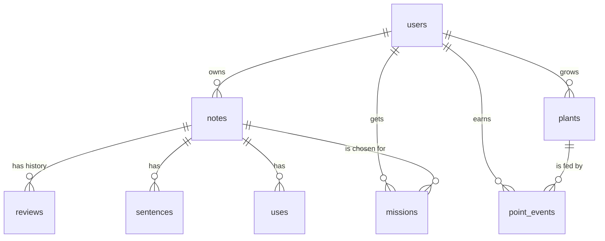

# The course app: Word Garden

A mobile-first web app for taking notes on the English you pick up, reviewing them on a spaced schedule, practising actively, and growing a plant.

## Screens

| Screen | What it does |
|---|---|
| **Sign up / Log in** | Create an account, get a token |
| **Garden** (home) | The plant under today's weather, progress, today's review count, the word of the day, the week's watering |
| **Review** | What is due today, practice shortcuts, a day-by-day schedule for the next 3 weeks |
| **Review session** | Flashcards: see the meaning, recall the phrase, reveal, grade Again / Hard / Good / Easy |
| **Notes** | Search and filter, add, edit, delete, add many at once, audio and a YouGlish link on each note |
| **Practice sessions** | Write your own sentences, say it out loud and compare with a recording |
| **Me** | Review pace, weather location, export and import, delete account |

## Data model



The full definition is in [`sample-data/schema.sql`](sample-data/schema.sql). Key ideas:

- A **note** holds the spaced-repetition state: `stage` (0 to 6), `due` (a date), `lapses`, `reps`.
- **reviews** is a history table: one row per graded review, never updated.
- A plant's growth is **not stored**. It is the `SUM` of its `point_events` (a ledger). Points earned when no plant is growing have `plant_id = NULL` and wait in the bank for the next seed.
- Two rules live in the database, not only in code: **one growing plant per user** and **one daily watering per user per day** (partial unique indexes).
- "Today" means the user's local date. Dates are `DATE` columns and `YYYY-MM-DD` strings in JSON.

## Review rules

Intervals after reaching each stage, in days: `[1, 3, 7, 14, 30, 60, 120]`. Levels: stage 0 New, 1-2 Learning, 3-4 Familiar, 5+ Known.

| Event | Stage | Next review |
|---|---|---|
| New note | 0 | tomorrow, or the next day with room |
| Again | back to 0, lapses + 1 | tomorrow |
| Hard | unchanged | `max(1, round(interval[stage] x 0.7))` days |
| Good | + 1 (max 6) | `interval[new stage]` |
| Easy | + 2 (max 6) | `interval[new stage]` |
| Wrong elsewhere ("slip") | - 1, only if the note is more than 1 day away | tomorrow, or next day with room |

**Room** means: no more than the user's `daily_cap` notes (default 10) are due on one day. A bigger batch spreads over consecutive days. A review never schedules earlier than its interval.

## Points and growth

| Source | Points |
|---|---|
| First learning action of the day (`water`) | 20, once per day |
| New note (`note`) | 5, up to 25 a day |
| Review Again / Hard / Good / Easy | 0 / 2 / 4 / 6 |
| Finish a review session | +10 |
| Sentence rated Natural / Not sure / Off | 6 / 3 / 1, finishing a round +10 |
| Spoken note rated Good / Needs work | 4 / 1, finishing a round +5 |
| Mission done (`mission`) | 10, once per day |

Plants and the growth they need: tomato 600, chilli 450, strawberry 500, sunflower 750, pumpkin 900, sugarcane 1100, bamboo 1300. Stages by progress: Seed (< 8%), Sprout (< 25%), Seedling (< 50%), Growing (< 75%), Budding (< 100%), Ready to harvest (100%). Growth is capped at the need. Extra points go to the bank. A plant with no studying for 3 days looks **thirsty** and never dies.

## Weather

The server asks [Open-Meteo](https://open-meteo.com/) (free, no API key) for `weather_code`, `is_day` and `temperature_2m`, rounds the user's coordinates to 2 decimals, caches the answer for 30 minutes and maps WMO codes to: clear (0), partly (1-2), cloudy (3), fog (45, 48), drizzle (51-57), rain (61-67, 80-82), snow (71-77, 85, 86), storm (95+).

## API

All routes are under `/api`. Everything except sign up, log in and health needs `Authorization: Bearer <token>`.

| Method and path | Purpose |
|---|---|
| `GET /health` | liveness check |
| `POST /users`, `POST /login` | sign up, log in |
| `GET /notes?q=&kind=`, `POST /notes`, `PUT /notes/:id`, `DELETE /notes/:id` | notes |
| `POST /notes/bulk` | add many |
| `GET /reviews/due`, `GET /reviews/schedule` | what to review, the next 3 weeks |
| `POST /notes/:id/reviews` `{ grade }` | grade a review |
| `POST /notes/:id/sentences`, `POST /notes/:id/uses` | practice records |
| `GET /garden`, `POST /garden/plant`, `POST /garden/harvest` | the plant |
| `POST /notes/:id/speak` `{ rating }` | spoken answer: Good or Needs work |
| `GET /practice/sentences` | five notes to write sentences with |
| `POST /practice/rounds` `{ mode, count }` | finishing bonus for a round |
| `GET /mission`, `POST /mission/done`, `POST /mission/swap` | word of the day |
| `GET /me`, `PUT /me`, `PUT /me/password`, `DELETE /me`, `PUT /me/location` | the user's settings, password, account and weather location |
| `GET /weather`, `GET /weather/search?q=` | sky for the saved location, city search |
| `GET /export`, `POST /import` | your data as JSON |

## Shapes

```ts
type Kind = 'phrase' | 'word';
type Note = { id: number; kind: Kind; text: string; meaning: string; example: string; note: string;
  stage: number; due: string; lastReviewed: string | null; reps: number; lapses: number; createdAt: string };
type Grade = 0 | 1 | 2 | 3;
type Garden = { plant: { id: number; type: PlantType; growth: number; need: number; stage: string; t: number } | null;
  bank: number; thirsty: boolean; week: boolean[]; collection: { type: PlantType; harvestedOn: string }[] };
```

## Things to remember

- **Every note belongs to one user.** A user can never read, change or delete another user's note.
- **The server is the authority** for dates, points and scheduling. The browser only asks. No endpoint accepts a points value from the client.
- **Audio is the browser's built-in speech** (American English voice) started from a tap. Recordings never leave the device.
- **Works on a phone and an iPad.** One column on a phone, two on an iPad in landscape.
